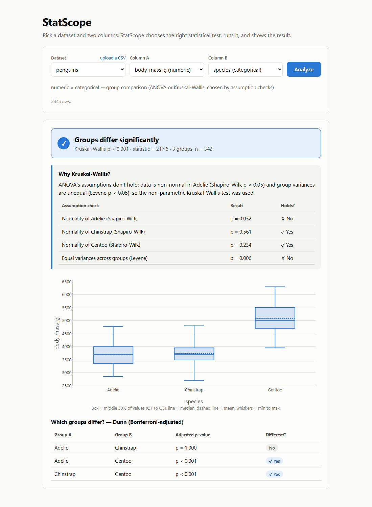
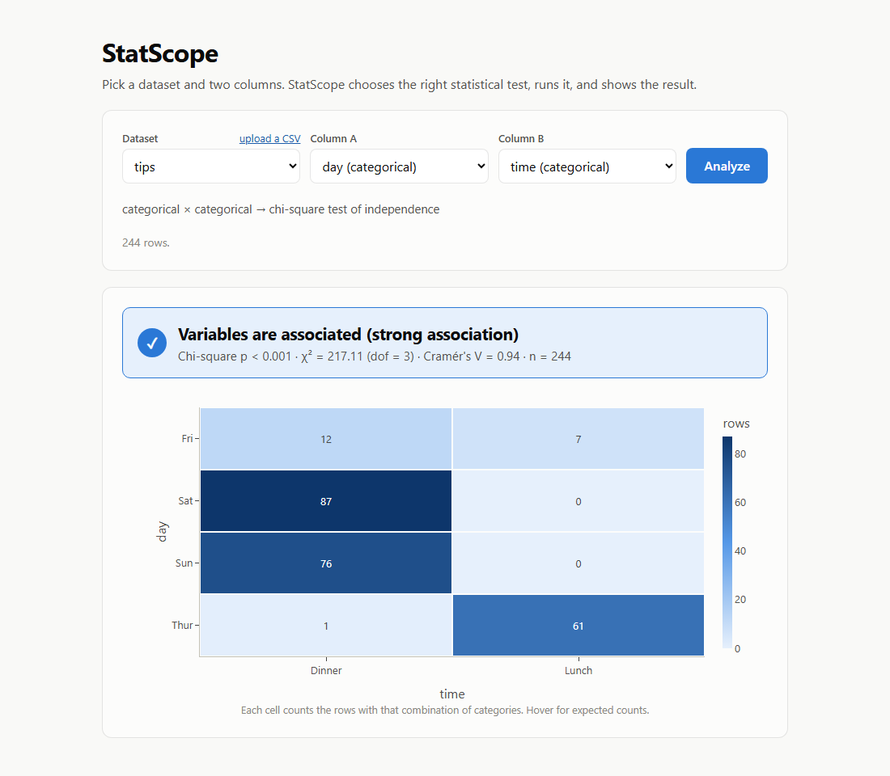
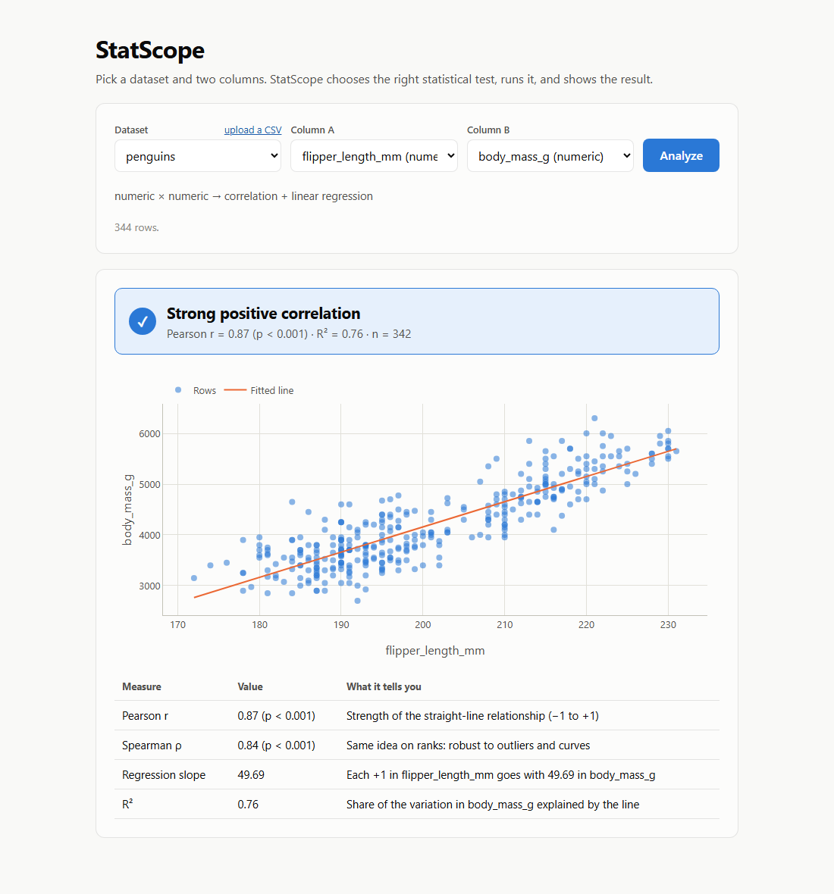
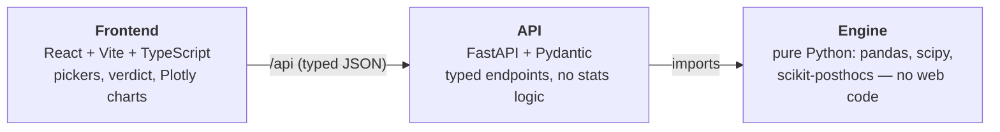

# StatScope

**Pick a dataset and two columns — StatScope picks the right statistical test, checks its
assumptions, runs it, and visualizes the result.**

Choosing the wrong test is one of the most common mistakes in applied statistics. StatScope encodes
the decision an analyst would make: it looks at the *types* of the two columns to choose the
analysis, and for group comparisons it *checks the assumptions* (normality, equal variance) before
deciding between ANOVA and Kruskal-Wallis — and tells you why.



## What it does

| Column pair | Analysis | Visualization |
|---|---|---|
| numeric × categorical | **Assumption checks** (Shapiro-Wilk per group, Levene) → **one-way ANOVA** (+ Tukey HSD) if they hold, otherwise **Kruskal-Wallis** (+ Dunn's test, Bonferroni-adjusted) | Box plot per group + pairwise table |
| categorical × categorical | **Chi-square test of independence** + **Cramér's V** effect size | Contingency heatmap |
| numeric × numeric | **Pearson** and **Spearman** correlation + **linear regression** (slope, R²) | Scatter plot + fitted line |

Those three pairings cover any two columns. Two public datasets (`penguins`, `tips`) are bundled so
it works instantly, and you can upload your own CSV.

| Chi-square | Correlation |
|---|---|
|  |  |

## Architecture

Three layers, strictly separated:



- **[backend/engine.py](backend/engine.py)** — all the statistics. Plain functions that take a
  DataFrame and return a dict. It never imports FastAPI, so it is unit-tested without a server.
- **[backend/app.py](backend/app.py)** — a thin translation layer: find the DataFrame, call the
  engine, return JSON. Every response is validated by a Pydantic model in
  [backend/schemas.py](backend/schemas.py).
- **[frontend/src](frontend/src)** — a pure rendering client. [types.ts](frontend/src/types.ts)
  mirrors the Pydantic models, so the contract is typed end to end. It branches on the result's
  `analysis` field to render the right view.

### How the test is chosen

```
analyze(df, col_a, col_b)
├─ numeric + categorical ──► run_group_comparison
│                             ├─ Shapiro-Wilk on every group  (are they normal?)
│                             ├─ Levene                       (equal variances?)
│                             ├─ both hold ──► ANOVA          ──► Tukey HSD post-hoc
│                             └─ otherwise ──► Kruskal-Wallis ──► Dunn's post-hoc
├─ categorical + categorical ─► run_chi_square   (chi-square + Cramér's V)
└─ numeric + numeric ─────────► run_correlation  (Pearson, Spearman, linear regression)
```

A numeric column with ≤ 10 distinct values (like party `size` in `tips`) is treated as categorical.
Bad input — one group, too few rows, an all-null or constant column — returns a clear
`insufficient_data` / `invalid_columns` message instead of an error.

## Run it

Requires Python 3.11+ and Node 20.19+ (or 22.12+).

**Backend** (from the repo root):

```bash
cd backend
python -m venv .venv
.venv\Scripts\activate          # macOS/Linux: source .venv/bin/activate
pip install -r requirements.txt
uvicorn app:app --reload
```

The API is now at http://localhost:8000 — try it in the Swagger UI at http://localhost:8000/docs.

**Frontend** (in a second terminal):

```bash
cd frontend
npm install
npm run dev
```

Open http://localhost:5173. The dev server proxies `/api` to the backend.

**Single-server mode** (what a deployment runs): build the frontend once with `npm run build`, and
FastAPI serves `frontend/dist` itself — the whole app is then at http://localhost:8000.

### Tests

```bash
cd backend
pytest
```

31 tests: the engine is covered with synthetic data (known-significant, known-null, normal →
ANOVA, skewed → Kruskal-Wallis, guards) and with known answers on the bundled datasets, plus API
round-trip tests including CSV upload.

| Known answer | Expected |
|---|---|
| penguins `body_mass_g` by `species` | Adelie fails Shapiro-Wilk (p ≈ 0.03), Levene p ≈ 0.006 → Kruskal-Wallis, H ≈ 217.6; Gentoo differs from both others, Adelie vs Chinstrap does not |
| tips `day` × `time` | χ² ≈ 217.1, dof = 3, Cramér's V ≈ 0.94 |
| penguins `flipper_length_mm` vs `body_mass_g` | Pearson r ≈ 0.87, Spearman ρ ≈ 0.84, slope ≈ 49.7 g/mm, R² ≈ 0.76 |

## API

| Endpoint | Purpose |
|---|---|
| `GET /api/datasets` | Names of the built-in datasets |
| `GET /api/columns?dataset=penguins` (or `?session=<id>`) | Column profile: which columns are numeric / categorical / excluded |
| `POST /api/upload` | Upload a CSV (multipart, ≤ 5 MB); returns a `session_id` plus its column profile |
| `POST /api/analyze` | Body `{dataset \| session, col_a, col_b}` → the result, tagged with an `analysis` field |

Uploads are held in memory only (no database) and disappear when the server restarts.

## Data

`penguins` (Palmer Penguins; Gorman, Williams & Fraser 2014) and `tips` (Bryant & Smith 1995) are
public sample datasets, bundled as CSV snapshots of the copies distributed with
[seaborn](https://github.com/mwaskom/seaborn-data). All results shown come from running the real
engine on this data.
